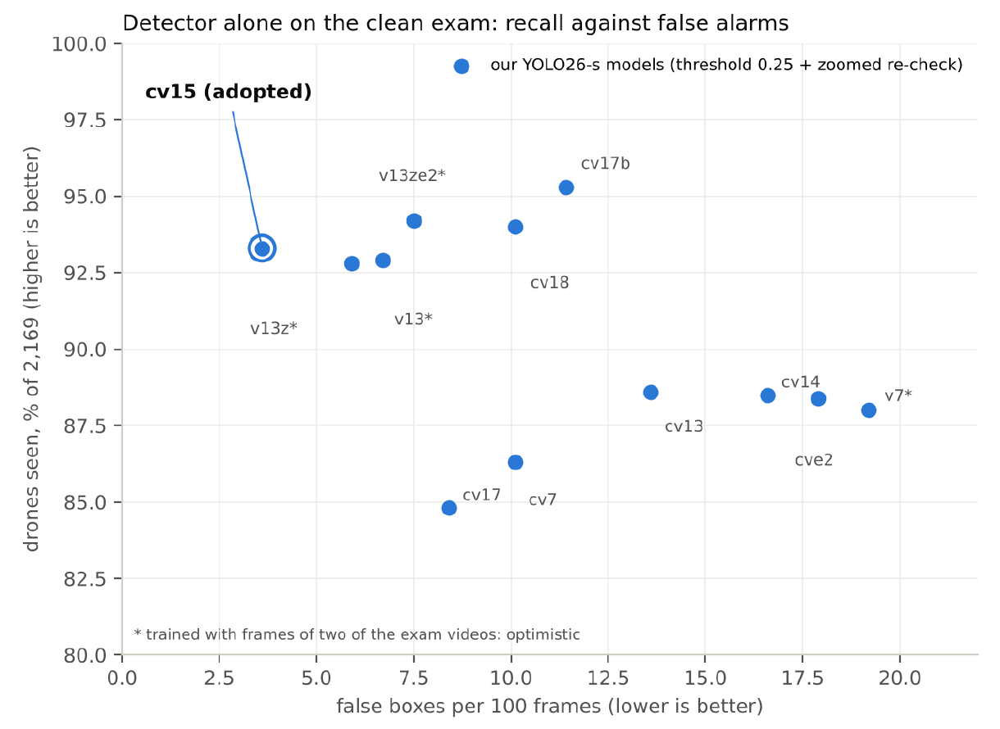
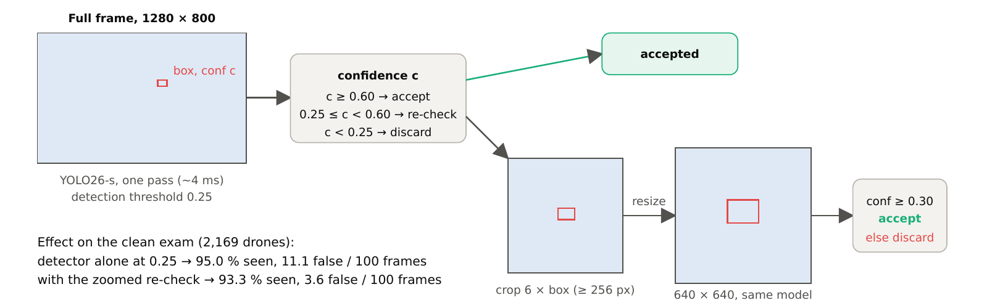
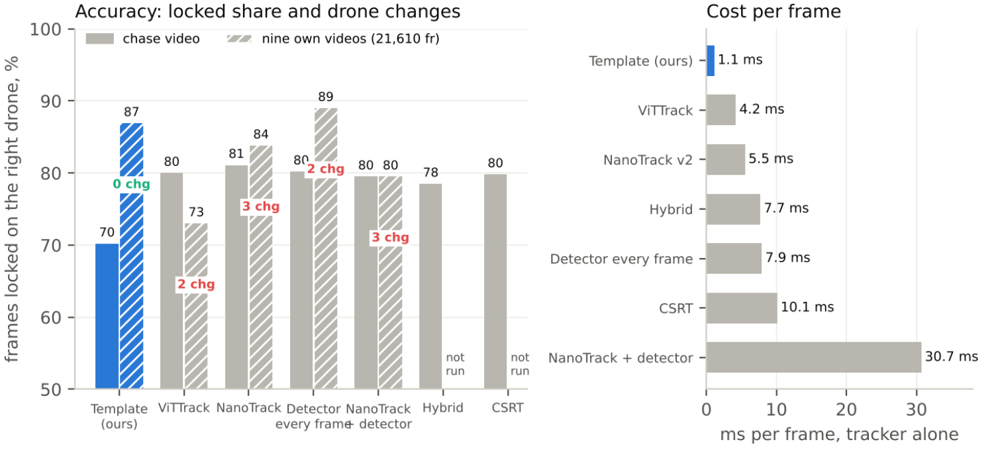

# Drone Volador — detecting and escorting a drone from another drone

**One small detector, a cheap tracker and strict test discipline.**
Personal side project, built in under a month (2026). Technical report (27 pages).

> Status: report published. Own footage, training configuration and flight code are not released.

## The problem

An *escort* quadcopter must find another drone with its own camera — any brand, no
markers, no cooperation — as early as possible, and then follow it at ≤ 15 m without ever
switching to the wrong target. No GPS. Outdoors, daylight.

Four constraints shaped everything:

- **Tiny targets.** 1280×800 global-shutter camera, 60° lens: a drone at 50 m is 10–20 px.
- **Tight budget.** Well under 30 ms per frame on a desktop GPU now, Raspberry Pi 5 + Hailo later.
- **Never jump to another drone.** Locking onto the wrong drone is the worst failure, worse than losing it for a second. Every tracker rule is "better lost than wrong".
- **Detection first.** The tracker is deliberately dumb (no Kalman, no learned motion). When in doubt it asks the detector.

## What was built

- A **single-class YOLO26-s detector** (9.5 M params), fine-tuned 80 epochs from the COCO checkpoint on **34,854 images** from five public sets plus own footage, exported to TensorRT FP16 at two input sizes (full frame 800×1280, crops 640×640).
- A **zoomed re-check**: medium-confidence boxes are re-examined by the *same* network on an upscaled crop. On the clean test set this cuts false boxes from 11.1 to 3.6 per 100 frames for 1.7 points of recall.

  
- A **~1 ms/frame region-of-interest tracker** (template matching at three scales + background-aligned motion fallback + coast-then-hold), with a detector confirmation thread every 0.1 s and a set of patience clocks that decide when to give up.
- An **appearance gallery** (shape + hue of the lights) to re-acquire the *same* drone after a loss and refuse look-alikes.
- A **multi-drone variant** that numbers every drone in view (formations, swarms) while escorting one.
- A **simulator** over real terrain used to choose the lens and to find that the weak link is camera→flight commands, not the flight controller.

## Results (hand-reviewed test videos never used for training)

| | Drones seen | False boxes / 100 frames | Cost per 1280×800 frame |
|---|---|---|---|
| Detector alone, threshold 0.25 | 95.0 % | 11.1 | ~4 ms (desktop GPU, TensorRT FP16) |
| Detector + zoomed re-check | **93.3 %** | **3.6** | ~4.5 ms |
| Escort loop (same test videos) | 92.5 % of frames locked on the right drone, 0.7 % wrong, **0 drone changes** | | ~2.5 ms/frame average while locked |

Five frame-to-frame trackers were compared on the same videos (NanoTrack v2, ViTTrack, CSRT, detector-on-crop, hybrids). The learned trackers hold on better through fast aspect changes of a close drone, but all of them changed drone two or three times on the own-video set; the template tracker was the only one with zero changes, and the cheapest by far (1.1 ms vs 4–31 ms).

## What did not work (fourteen things, measured)

Synthetic drones pasted over ground · bird photos and generic COCO images as negatives · 50/60/70 epochs instead of 80 · hard-mining our own failure cases · fine-tuning a general model on our videos (catastrophic forgetting) · training from scratch · re-weighting own footage against public sets · YOLO26-n · a second classifier to reject false positives · a stationary-object filter · chained fine-tunes · … Each with the number that killed it. See Section 6 of the report.

The two lessons that mattered most: **variety over volume** (a new *kind* of footage moves the test score; more frames of a known scene does not), and **extra epochs buy precision, not recall** — and precision is what keeps the tracker from jumping.

## Evaluation discipline

- No trust in mAP on a public split. Every model is scored on own videos, **detector alone** and **inside the escort loop**, because a model that looks better alone can make the tracker jump.
- Exam videos are never used for training in any way. Removing them cost about two points on paper and gave numbers we can trust.
- Everything scripted: after each training, one script exports the engines and runs the whole battery (~40 min), so every model in the history was measured the same way.

## Training data (public part)

DUT Anti-UAV (train split), the FPV chase and NTUT air-to-air sets from Roboflow Universe, sky-only synthetics, and hand-reviewed frames from public videos with matching negatives, plus own footage (not released). Ultralytics YOLO26-s from the COCO checkpoint, 80 epochs, framework defaults. See Sections 3 and 9 of the report.

## Files

- `report/drone_escort_detector_report_public.pdf` — the full technical report (27 pages)
- `figures/` — the three figures used above

## Author

Javier Chaos — software architect / tech lead (.NET, Azure, Python/computer vision).
[LinkedIn](https://www.linkedin.com/in/javierchaos/) · [GitHub](https://github.com/jachaos)

## Licence

Report and text: CC BY 4.0. Public datasets keep their own licences (see references in the report).
